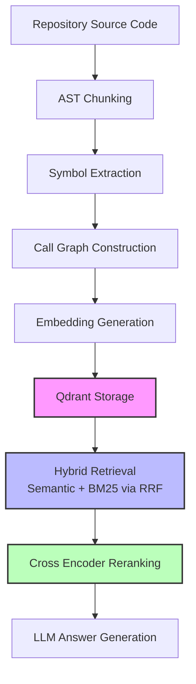
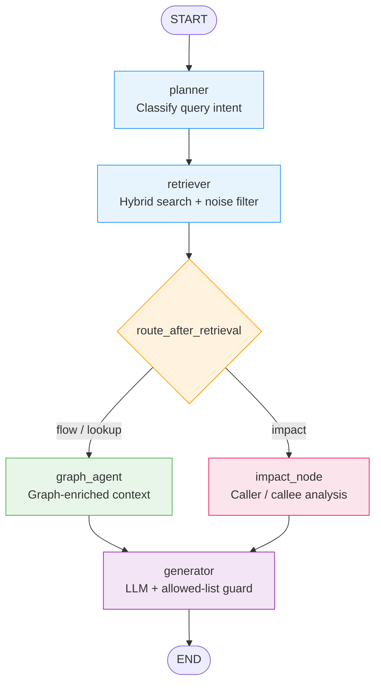

# Codebase RAG

Repository-aware Retrieval-Augmented Generation system for deep codebase understanding — using AST parsing, call graph traversal, hybrid search, and a LangGraph-orchestrated 5-node agent pipeline.

---

## Table of Contents

- [Current Status](#current-status)
- [Stack](#stack)
- [Ingestion Pipeline](#ingestion-pipeline)
- [LangGraph Workflow](#langgraph-workflow)
- [Setup](#setup)
- [Index Repositories](#index-repositories)
- [Run Agent](#run-agent)
- [RAGAS Evaluation](#ragas-evaluation)
- [Current Limitations](#current-limitations)
- [Next Priorities](#next-priorities)

---

## Current Status

### Indexed Repositories

| Repository | Status |
|------------|--------|
| Flask      | ✅ Indexed |
| Werkzeug   | ✅ Indexed |

### Graph Statistics

| Metric          | Count  |
|-----------------|--------|
| Chunks          | ~4,056 |
| Edges           | ~15,670 |
| Calls           | ~12,791 |
| Resolved Calls  | ~3,806 |

---

## Stack

| Layer | Technology |
|-------|-----------|
| Language | Python |
| Vector Store | Qdrant |
| Embeddings | Sentence Transformers |
| Reranking | Cross Encoder (ms-marco) |
| Parsing | AST-based code chunker |
| BM25 | Rank-BM25 |
| Orchestration | LangGraph |
| LLM | Groq (llama-3.3-70b-versatile) |
| Evaluation | RAGAS + Mistral |

---

## Ingestion Pipeline



---

## LangGraph Workflow

The agent is orchestrated as a **5-node LangGraph pipeline** with conditional routing after retrieval.

### Nodes

| Node | Role |
|------|------|
| `planner` | Classifies the query intent: `flow`, `lookup`, or `impact` |
| `retriever` | Runs hybrid search + filters noise/test files |
| `graph_agent` | Builds graph-enriched context for `flow` / `lookup` queries |
| `impact_node` | Builds caller/callee impact analysis for `impact` queries |
| `generator` | Calls LLM with structured prompt + allowed-list hallucination guard |

### Routing Logic

After `retriever`, the graph applies **conditional routing**:

- If `query_type == "impact"` → routes to `impact_node`
- Otherwise → routes to `graph_agent`

Both `graph_agent` and `impact_node` converge back into `generator` → `END`.

### Workflow Diagram



### State Schema

```python
class AgentState(TypedDict):
    question:          str
    query_type:        str        # "flow" | "lookup" | "impact"
    retrieval_results: List
    graph_context:     str
    answer:            str
    confidence:        float
    retry_count:       int
    fn_list:           str        # allowed functions (hallucination guard)
    file_list:         str        # allowed files (hallucination guard)
```

### Query Type Routing Rules

| Signal in Question | `query_type` |
|--------------------|--------------|
| `"what calls"`, `"who calls"`, `"callers of"` | `impact` |
| `"what breaks"`, `"if i change"`, `"modify"` | `impact` |
| `"where is"`, `"find"`, `"locate"` | `lookup` |
| *(default)* | `flow` |

### Running the LangGraph Agent

```bash
python langgraph_agent.py
```

Or invoke programmatically:

```python
from langgraph_agent import app

result = app.invoke({
    "question": "How does request dispatching work?",
    "query_type": "flow",
    "retrieval_results": [],
    "graph_context": "",
    "answer": "",
    "confidence": 0.0,
    "retry_count": 0,
    "fn_list": "",
    "file_list": ""
})

print(result["answer"])
```

---

## Setup

### Create Environment

```bash
# macOS / Linux
python -m venv venv
source venv/bin/activate

# Windows
python -m venv venv
venv\Scripts\activate
```

### Install Dependencies

```bash
pip install -r requirements.txt
```

### Environment Variables

Create a `.env` file in the project root:

```env
GROQ_API_KEY=your_groq_key_here
MISTRAL_API_KEY=your_mistral_key_here   # only needed for RAGAS evaluation
```

### Start Qdrant

```bash
docker run -p 6333:6333 qdrant/qdrant
```

---

## Index Repositories

Configure repositories in `rag_config.json`:

```json
{
  "repos": [
    "flask_repo",
    "werkzeug_repo"
  ],
  "boost_dirs": ["src", "lib", "core", "app"],
  "penalize_dirs": ["tests", "test", "docs", "benchmarks"],
  "noise_dirs": ["examples", "tutorial"],
  "rerank_score_cutoff": -3.0
}
```

**Step 1 — Parse and build call graph:**

```bash
python chunker.py
```

**Step 2 — Generate embeddings and store in Qdrant:**

```bash
python ingest.py
```

---

## Run Agent

### Simple agent (no LangGraph):

```bash
python agent.py
```

### LangGraph agent (recommended):

```bash
python langgraph_agent.py
```

### Example questions

| Query Type | Example Question |
|------------|-----------------|
| `flow`     | How are blueprints registered? |
| `flow`     | How does request dispatch work? |
| `flow`     | How is session handling implemented? |
| `flow`     | How does template rendering work? |
| `lookup`   | Where is `save_session` implemented? |
| `impact`   | What breaks if `register_blueprint` changes? |
| `impact`   | Who calls `dispatch_request`? |

---

## RAGAS Evaluation

RAGAS evaluation was run against **10 benchmark questions** covering Flask's core flows. Evaluation used `Mistral Large` as the judge LLM and `mistral-embed` for embeddings.

### Metrics

| Metric | Description |
|--------|-------------|
| **Faithfulness** | Are claims in the answer grounded in the retrieved context? |
| **Answer Relevancy** | Is the answer on-topic for the question? |
| **Context Precision** | Are retrieved chunks actually relevant? |
| **Context Recall** | Does the retrieved context cover the ground truth? |

### Per-Question Results

| Question | Faithfulness | Answer Relevancy | Context Precision | Context Recall |
|----------|:------------:|:----------------:|:-----------------:|:--------------:|
| How are blueprints registered? | 0.316 | — | — | — |
| How does request dispatching work? | — | — | — | — |
| How are routes registered? | — | — | — | 0.500 |
| How are before_request handlers executed? | — | — | — | — |
| How does teardown_appcontext work? | — | — | — | — |
| Where is save_session implemented? | 0.160 | 0.853 | — | 0.000 |
| What breaks if register_blueprint changes? | — | — | — | 0.000 |
| How are error handlers resolved? | — | — | — | — |
| How does URL matching work? | — | — | — | — |
| How are sessions saved? | 0.160 | 0.853 | — | 0.000 |

### Aggregate (available scores only)

| Metric | Avg | Min | Max | Scored |
|--------|-----|-----|-----|--------|
| Faithfulness | 0.238 | 0.160 | 0.316 | 2 / 10 |
| Answer Relevancy | 0.853 | 0.853 | 0.853 | 1 / 10 |
| Context Precision | — | — | — | 0 / 10 |
| Context Recall | 0.167 | 0.000 | 0.500 | 3 / 10 |

> [!NOTE]
> Most RAGAS metrics returned `null` because the Mistral judge timed out or hit API limits mid-run. The low faithfulness scores reflect the LLM citing file paths not strictly grounded in the retrieved chunks — an area being actively improved via the allowed-list hallucination guard injected into every prompt.

> [!TIP]
> Context recall of 0.5 on "How are routes registered?" shows the hybrid retriever is surfacing relevant chunks. Improving chunk filtering and reranking thresholds should push recall higher across all questions.

### Running the Evaluation

```bash
# Build dataset from benchmark questions
python eval/build_eval_dataset.py

# Run RAGAS scoring
python eval/run_ragas.py
```

---

## Current Limitations

- Symbol resolution still misses many indirect calls.
- Retrieval occasionally surfaces test files instead of implementation code.
- Multi-hop graph traversal needs improvement.
- Repository-specific ranking not yet implemented.
- RAGAS evaluation is incomplete due to API rate limits during the judge LLM run.
- `context_precision` could not be scored (requires ground-truth reference chunks).

---

## Next Priorities

1. Improve context recall — better chunk filtering and reranking thresholds.
2. Improve symbol resolution — resolve more indirect/dynamic calls.
3. Expand graph traversal — multi-hop paths beyond depth 1.
4. Complete RAGAS benchmark — full scoring across all 10 questions.
5. Multi-repository support beyond Flask / Werkzeug.
6. Add retry logic to LangGraph agent when `confidence < 0.5`.

---

## Version

Current checkpoint: **v0.2** — LangGraph 5-node pipeline with conditional routing + RAGAS evaluation.
